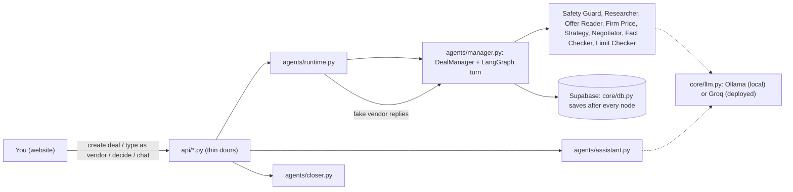
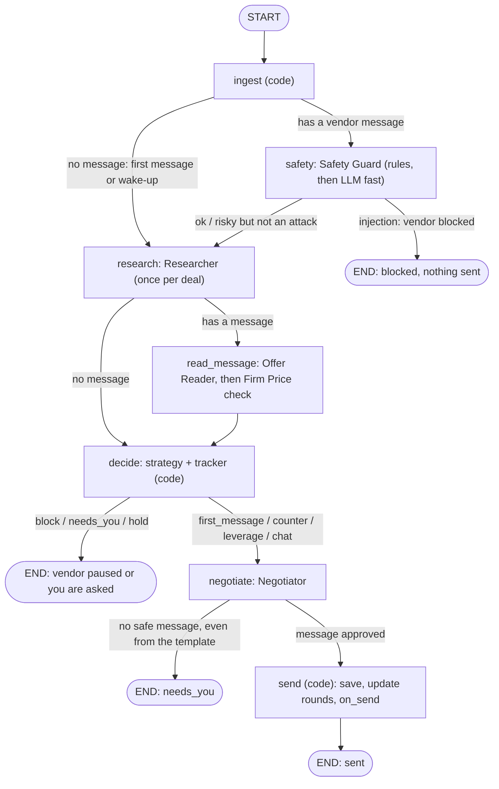
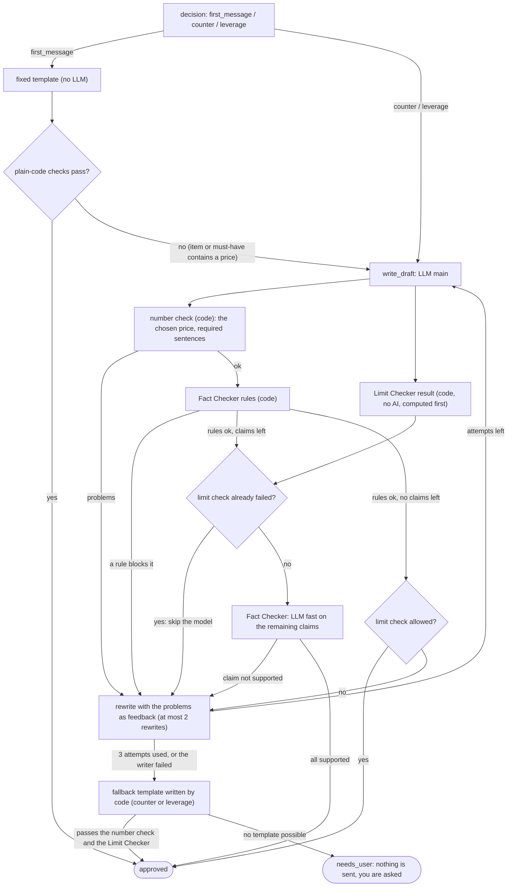
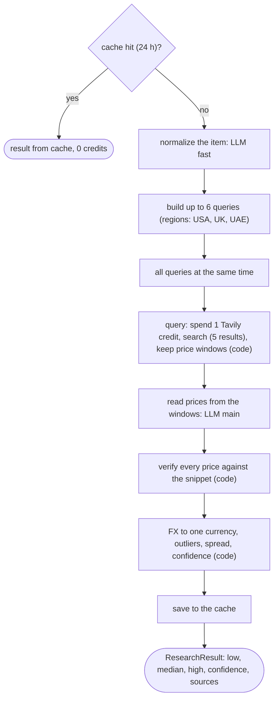
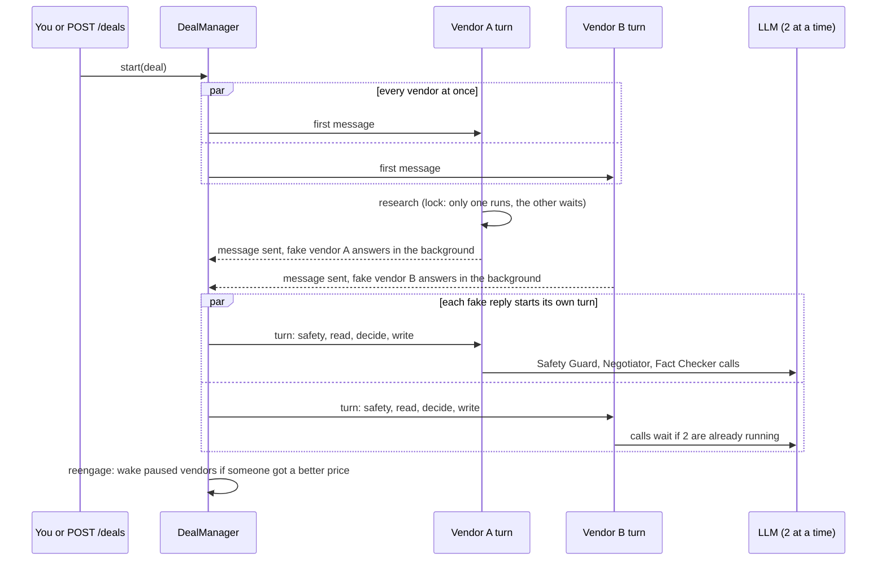
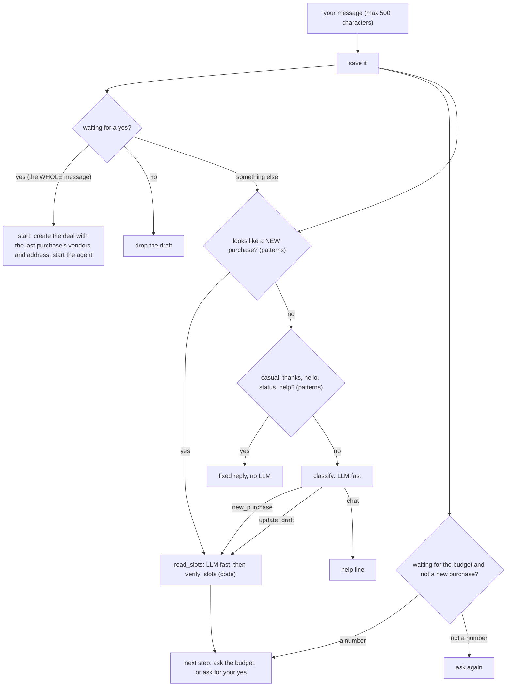
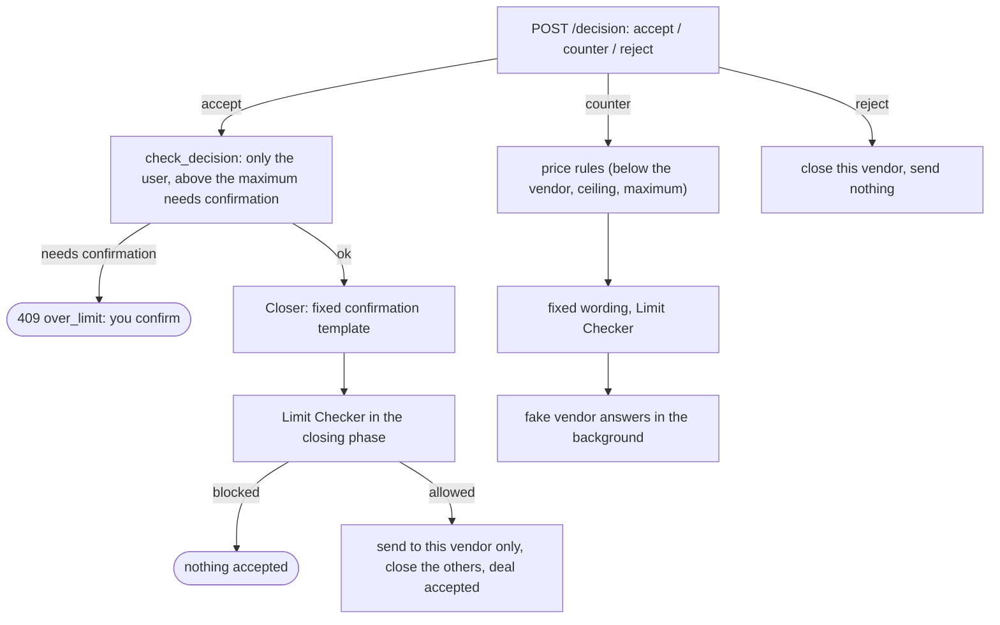
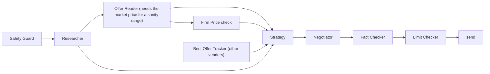

# Agent execution flow

**This file is the source of truth for how the agents run today.** It describes the code that exists now, not a plan.
It must be updated in the same step as any change to the pipeline (see "How to keep this file true" at the end).
Token numbers live in [docs/TOKEN_USAGE.md](docs/TOKEN_USAGE.md), which is built from real measurements.

Paths are under `backend/app/`. "LLM" means a call to the language model through `core/llm.py`, the only place that calls a model.

---

## 1. The big picture

DealDesk has three pipelines and five side flows. **Plain code orchestrates all of them. No LLM decides which step runs next.**

| # | Pipeline | Main file | Triggered by |
|---|---|---|---|
| 1 | **Vendor turn**: one LangGraph graph per vendor message | `agents/manager.py` (`build_graph`, `DealManager`) | a new deal, a vendor message (real, typed by you, or from a fake vendor), a wake-up |
| 2 | **Assistant chat**: your message to DealDesk | `agents/assistant.py` (`handle`) | `POST /assistant/message` |
| 3 | **Decisions**: accept, counter, reject, finish | `agents/closer.py`, `agents/runtime.py` (`decide`) | `POST /deals/{id}/decision`, `/finish` |
| side | **Try to trick it**: pipeline 1 on a throwaway copy | `agents/runtime.py` (`trick`) | `POST /trick` |
| side | **Restart recovery** | `core/resume.py`, `agents/runtime.py` (`resume_vendor`) | server start, `GET /deals/{id}` |
| side | **Evaluation run** (offline, never reachable from the public API): the product (`safety_on`) and an unprotected baseline (`safety_off`) over fixed scenarios, an attack suite, metrics and a weighted rubric | `evals/runner.py` | `uv run python -m app.evals.runner` |
| side | **Search again**: after a failed research, `POST /deals/{id}/research/retry` clears the research, searches again (uses search credits) and lets every open vendor continue | `agents/runtime.py` (`retry_research`) | the "Search again" button on the deal page |
| side | **Parse request**: one sentence into form fields, starts nothing | `api/parse.py` (uses `read_slots` from `agents/assistant.py`) | `POST /parse-request` |



### Execution tree (who calls whom)

```
POST /deals ──► runtime.start_deal ──► DealManager.start ──► [all vendors at the same time]
                                                              └─ run_turn(vendor, no message) ──► graph (first message)
fake vendor / you ──► DealManager.on_vendor_message ──► run_turn(vendor, message) ──► graph
                                                       └─ reengage ──► run_turn(paused vendors with a new reason to talk)
graph (one vendor turn):
   ingest ─► [safety] ─► research ─► [read_message] ─► decide ─► negotiate ─► send ─► (on_send ─► fake vendor reply ─► on_vendor_message)
POST /assistant/message ──► handle ──► patterns ─► [classify LLM] ─► [read_slots LLM] ─► verify ─► template reply ─► [yes] ─► create deal ─► start_deal
POST /deals/{id}/decision ──► closer.accept | counter | reject (code only) ──► [counter] fake vendor reply
POST /trick ──► runtime.trick ──► graph on a COPY of the deal (nothing saved, nothing sent)
```

---

## 2. Pipeline 1: the vendor turn

One turn handles one vendor, from one message (or from "no message" for the first message and for wake-ups).
Implementation: `build_graph` in `agents/manager.py`. A node reads and updates the deal record and saves it (`DealStore.save`).



### Node by node

| Node | Runs after | Trigger / condition | Input | Output (state it passes on) | LLM (role, local / deployed) | Tools and APIs | Waits for |
|---|---|---|---|---|---|---|---|
| **ingest** | START | always | vendor id, message text or none, `simulated`, `replay` flags | the message appended to the vendor chat (not on a replay) | none | `DealStore` (Supabase) | the vendor lock (a vendor never has two turns at once) |
| **safety** (Safety Guard `agents/safety_guard.py`, 48 rules in `safety_rules.py`) | ingest, only when there is a message | a vendor message arrived | message text | `safety_verdict`, `safety_needs_user`; vendor `blocked` on an injection. **On the first message of a deal it also starts the research at the same time** (section 4) | `fast`: llama3.1:8b / llama-3.1-8b-instant, **only if the rules found no injection** | none | nothing |
| **research** (Researcher `agents/researcher.py`) | safety (it may already be running), or ingest when there is no message | `deal.research` is empty | item, variant, must-haves, currency | `deal.research` (low, median, high, confidence, sources) | `fast` normalize the item, `main` read prices (see section 3) | Tavily (basic search), FX APIs, Supabase cache and credit counter | the research started next to the safety check, and a per-deal lock, so five vendors cause ONE research |
| **read_message** (Offer Reader `agents/offer_reader.py`, add-ons `negotiation/addons.py`, Firm Price `agents/firm_price.py`) | research, only when there is a message | a vendor message arrived | message text, wanted variant, market median as a sanity range | `vendor.offer`, `stall_count`, `variant_prices`, `addons`, `firm`, `firm_pushes`, `parse_failed` | `fast`, **only when ambiguous**: Offer Reader if several prices or a price next to a delivery or color word; Firm Price only for soft wording | price parser (code) | nothing. **The Offer Reader and the Firm Price check run at the same time** |
| **decide** (`negotiation/strategy.py`, `negotiation/tracker.py`) | read_message, or research when there is no message | always. **A vendor that has not quoted a price gets the first message even when the research failed** (it contains no number). Without a market price the agent will not counter. | `Situation`: research, safety, vendor state, other vendors' best price, effective price | a `Decision`: block, needs_you, hold, first_message, counter, leverage or chat, with the price | none (plain code) | none | nothing |
| **negotiate** (Negotiator `agents/negotiator.py`) | decide, when the action writes a message | action is first_message, counter, leverage or chat | the decision, the last 4 chat turns, the research, the tactics, the extras you value | an approved message text, or `needs_user` | `main`: llama3.1:8b / llama-3.3-70b-versatile. **None for the first message** (a fixed template) | none | the model semaphore (2 calls at a time locally, 3 on Groq) |
| **send** | negotiate | message approved | the approved message | chat updated, `last_counter`, `rounds`, `last_leverage`, `firm_pushes`; `on_send` called | none | `Runtime.on_send` (delivers to the channel) | nothing |

`stop` is set by `safety` (injection), `decide` (block, needs_you, hold) and `negotiate` (no safe message). A set `stop` ends the turn at once.

### Branches, loops, retries and fallbacks

| Where | What happens |
|---|---|
| `DealManager.run_turn` | A vendor whose status is `blocked` or `closed` is not processed. The message is saved, a `closed` vendor's message still gets a Safety Guard check, and the agent never replies there. A model error (`LLMError`) ends the turn with `needs_you` (`model_error`): fail closed. |
| `read_message` | A price the Offer Reader cannot be sure of becomes `unclear`, and `decide` asks you. |
| `decide` | Rules in order: injection, safety review, research missing or low, price unreadable, no price yet, good price, vendor met our counter, firm-price tries used up, rounds used up, stalled, budget too low, then a counter. A good price while other vendors still negotiate becomes `hold`. |
| `DealManager.reengage` | After every vendor message, paused vendors are written to again if ANOTHER vendor has a better price they were not told yet and they have rounds left. It loops until nobody was written to (stop at 20 passes). |
| `core/llm.py` | Bad JSON: up to 2 retries with the error. A 400 from the host (for example Groq "failed to generate JSON") is asked again like bad JSON, then becomes an `LLMError`; any other host error also becomes an `LLMError` (never an uncaught crash). On Groq `gpt-oss` models every call sets `reasoning_effort=low` and `max_completion_tokens=4000`. HTTP 429: waits 1 s, 2 s, 4 s, 8 s (or the host's `Retry-After`, at most 15 s; Groq's per-minute limit needs it), then tries the fallback model once. Budget: 600 calls a day and 300 per deal, counted in a database function. |

---

## 3. Inside two agents

### Negotiator (writes the buyer's message)



- **Facts passed in:** price chosen by code, the last 4 chat turns to the writer (the Fact Checker gets the last 6), research low, median, high and 2 source names, tactics (exact sentences), the extras you value, the leverage and keep-the-extra sentences. **Never passed:** your maximum price, address, phone.
- **Fact Checker** (`agents/fact_checker.py`, 27 rules in `fact_rules.py`): rules first; sentences with no claim, exact approved sentences and repeats of the vendor's words are removed; only what is left is sent to the model as numbered yes or no questions. No statements left means no model call.

### Researcher (market price)



- Runs once per deal. With `RESEARCH_MODE=fixed` it is replaced by a demo price (no search, no LLM).
- Failures: credits used up or search down gives fewer results; no verified price gives `available=false`, and `decide` then asks you instead of guessing.

---

## 4. Parallel and sequential execution today

| What | How it runs |
|---|---|
| **Different vendors** | **In parallel.** `DealManager.start` runs every vendor's first turn at the same time (`asyncio.gather`). Each fake vendor reply is a background task that starts a new turn for its own vendor. |
| **Two turns of the same vendor** | Never at once (a lock per deal and vendor). |
| **Nodes inside one turn** | **Sequential:** ingest, safety, research, read_message, decide, negotiate, send. Two exceptions, both below: research starts next to the safety check, and the two reads inside read_message overlap. |
| **Safety check and research (first message of a deal)** | **In parallel.** The `safety` node starts the research as a background task before it calls the model, and the `research` node waits for it. If the message was an attack the research is simply not used. |
| **Research** | Once per deal (lock). **Its up to 6 searches and their reading run in parallel.** |
| **Offer Reader and Firm Price check** | **In parallel** (`asyncio.gather` in `read_message`). Each uses the model only when its rules are unsure. |
| **The model** | A semaphore lets only 2 calls run at a time locally (3 on Groq), so "parallel" vendors queue for the model when it is the slow part. |
| **Wake-ups (`reengage`)** | The woken vendors run in parallel with each other. |
| **Assistant, decisions** | Single path, one request at a time. |



---

## 5. Pipeline 2: the Assistant chat



- **LLM calls:** `classify` (`fast`, only for text no pattern recognised) and `read_slots` (`fast`, for a new purchase or a change). Everything else is code and fixed templates.
- **Code checks the model:** the item words must be in your text, and the maximum price comes only from the price parser.
- **Human step:** nothing starts until you answer a clear yes.

---

## 6. Pipeline 3: decisions (Closer) and the side flows



No LLM is used in decisions.

| Side flow | How it runs |
|---|---|
| **Try to trick it** (`/trick`) | A deep copy of the deal goes into a throwaway store and pipeline 1 runs on it (`on_send` is captured, nothing real is saved or sent). Same LLM calls as a normal turn. |
| **Restart recovery** | On server start (and on every `GET /deals/{id}`) `resume_pending` claims vendors with an expired lease. `resume_vendor` does only what is missing: send the first message, answer an unanswered vendor message (a replay, not saved twice), or ask the fake vendor to answer. **Each of these re-checks its condition inside the vendor lock** (the `guard` argument of `run_turn`), so recovery never repeats what a turn that is running right now is doing. |
| **Evaluation run** | `evals/runner.py` builds fixed scenarios (`evals/scenarios.py`: 5 personas over 5 products, 3 vendors per deal, a known market range instead of research). **`safety_on`** runs the deal through the same Runtime and Manager as the product (fake vendors answer, a scripted owner then accepts the lowest advised offer within the maximum, through the real Closer). **`safety_off`** runs the same vendors against the baseline agent, which decides alone and is told the maximum and the address. The attack suite (`evals/attacks.py`: the 30 simulator attacks plus 3 more) goes to the Safety Guard (protected) or to the raw model (baseline). Metrics (`evals/metrics.py`) and the weighted rubric (`evals/rubric.py`) are computed by code from the transcripts. The result is saved to `evals/results/*.json` and to the `eval_runs` table, and `GET /scorecard` returns the latest run per mode. |
| **Parse request** | `POST /parse-request` sends your sentence through `read_slots` (LLM `fast`), then code keeps only the words your text supports, and the price parser finds the maximum price. It returns the fields and a note on what to check. It creates no deal and contacts no vendor. Used by the Buy page "Fill the form" box and by the buyer box on the WhatsApp page. |
| **Take control** | A vendor with `played_by = you` is never answered by the simulator. You type, and your message enters pipeline 1 like any vendor message. |

---

## 7. Models, tools and APIs

### Which model each agent uses

| Role | Local (`APP_ENV=local`) | Deployed (`APP_ENV=production`) | Used by |
|---|---|---|---|
| `fast` | llama3.1:8b via Ollama | openai/gpt-oss-20b via Groq | Safety Guard, Fact Checker, Offer Reader, Firm Price check, Researcher normalize, Assistant classify and read_slots, and (evaluation only, `evals/judge.py`) the Judge, which grades the tone of each vendor chat 1 to 5 (natural, relevant, patient, varied) and never decides a price, a limit or a pass or fail |
| `main` | llama3.1:8b via Ollama | openai/gpt-oss-120b via Groq (fallback openai/gpt-oss-20b after rate limits) | Negotiator, Researcher price reading |

**Groq model names:** chosen from the models this project's Groq key lists (3 Oct 2026: it does not list the Llama models) and smoke tested with the project's JSON calls (about 0.6 seconds a call). The answers include the model's own reasoning tokens, so output token counts are higher than on Ollama.

### Which agents call the LLM, and when

| Agent | LLM call | Always? |
|---|---|---|
| Safety Guard | second-layer check | every vendor message the rules did not already block as an injection |
| Fact Checker | yes or no per claim | only when claims remain after the rules |
| Offer Reader | choose the price among several | only when ambiguous |
| Firm Price check | "is the vendor refusing to go lower" | only for soft wording |
| Negotiator | write a counter or leverage message | every counter and leverage; never for the first message |
| Researcher | normalize the item; read prices per search | once per deal, 1 plus up to 6 calls; none on a cache hit or in fixed mode |
| Assistant | classify; read slots | only for unusual text; for each new purchase or change |
| Baseline agent (`evals/baseline.py`, evaluation only) | decide counter, accept or reject and write the message, with NO protection | only inside the evaluation runner and the attack suite. Never in the product. |
| Parse request (`api/parse.py`) | read the item, variant and must-haves | once per `POST /parse-request`. The maximum price and currency come from code, never from the model. If the model fails, code still returns the price and currency. |
| Simulator (`simulator/vendor_sim.py`, the fake vendors) | optional: one sales sentence (`fast`) | never in the running product: the Runtime gives it no model, so replies come from templates. Prices are always chosen by code. |

### Tools and APIs

| Tool | Used by | What for |
|---|---|---|
| Ollama (local) or Groq (deployed), `core/llm.py` | every LLM call | language model. Budget counter, concurrency limit, retries, fallback, token usage log |
| Tavily search (basic, 1 credit) | Researcher | web search, capped at 800 credits a month |
| open.er-api.com, then jsDelivr, then a built-in table | Researcher | currency rates |
| Supabase Postgres, `core/db.py` | every node, the Assistant, the budget, research cache, leases | state saved after every node |
| Price parser `guardrails/prices.py` | Limit Checker, Offer Reader, Assistant | finds every price in a text (code) |

---

## 8. Data passed between agents

| Between | Data |
|---|---|
| graph state `TurnState` | `deal_id`, `vendor_id`, `message`, `simulated`, `replay`, `safety_verdict`, `safety_needs_user`, `parse_failed`, `stop`, `decision`, `outbound`, `outcome` |
| everything else | the deal record (`schemas/records.py`) in the store: `DealRecord` (item, variant, extras you value, maximum price, address, research, tactics, status) and one `VendorRecord` per vendor (offer, counters, rounds, firm, addons, variant prices, chat, timeline events, `played_by`) |
| strategy to Negotiator | a `Decision` (action, counter price, leverage price, firm push flag, reason) |
| Negotiator to send | an `Outbound` (text, action, counter price, leverage price) |
| tracker to strategy | the best other price (never a name), whether others are still negotiating, the effective price credit |

---

## 9. Dependencies between agents



- **Strategy** needs: the Safety Guard's verdict, the research, the price from the Offer Reader, the firm flag, and the tracker.
- **Negotiator** needs only the strategy's decision (it never chooses a price).
- **The Limit Checker** depends on nothing else and runs last.

---

## 10. Where the pipeline waits for a person

| Situation | Status | What you do |
|---|---|---|
| Safety Guard wants a person to look | `needs_you` | read the message, decide |
| Research missing or low confidence | `needs_you` | check the item name, or decide yourself |
| Price could not be read | `needs_you` | read the chat |
| Rounds used, stalled, firm price after the tries, good price (last vendor) | `needs_you` | decide with the advice |
| The writer could not make a message that passes every check | `needs_you` | decide |
| The model failed (down, out of budget) | `needs_you` | decide, or retry later |
| All vendors finished | final pick card | **Accept**, choose another, **Reject all** (only you can accept) |
| Accept above your maximum, counter above the ceiling | 409 confirmation | confirm or cancel |
| Assistant has a complete purchase | waiting for a yes | say yes or no |
| A vendor played by you | waiting | type as the vendor |

---

## 11. Opportunities for parallel execution and optimization

| Opportunity | Status | Expected effect |
|---|---|---|
| Run the Safety Guard and the Researcher at the same time on the first message of a deal | **done** | saves a model wait on the first vendor message of every deal. No token change. |
| Run the Offer Reader and the Firm Price check at the same time | **done** | saves a model wait when both need the model. No token change. |
| Use the Limit Checker result (code, free) before the Fact Checker's model call | **done** | saves a Fact Checker call whenever a draft that would call the model already fails the limit check. |
| Compact JSON shape instead of the full JSON schema in every `complete_json` call | **done** | fewer input tokens in every call. |
| Fewer chat turns: the writer 8 to 4, the Fact Checker the whole chat to 6 | **done** | fewer input tokens in each counter and each fact check. |
| Drop the duplicate JSON-format paragraph in the Fact Checker prompt | **done** | fewer input tokens in each Fact Checker call. |
| Shorten the Safety Guard prompt (about 60% of every Safety Guard call is its fixed instructions and examples) | not done | would need the 30 attack messages re-checked with the real model first, because it is a safety prompt. |
| Skip the Researcher's item-name normalization when the item text is already clean | not done | one fewer small call per deal, but risks worse search queries. |
| Cache a Safety Guard verdict for an identical message | not planned | small |

The measured effect of each change is in [docs/TOKEN_USAGE.md](docs/TOKEN_USAGE.md).

---

## How to keep this file true

Update this file in the same step as any change to:
a new, removed or reordered agent or graph node; dependencies; parallel or sequential execution; a model, role or provider;
a tool or API; a prompt; routing or decision rules; retries or fallbacks; data passed between agents.

Two tests guard it: `tests/test_docs_in_sync.py` fails when a graph node, a labelled agent or a model role is missing from this file.
After a change that affects model calls, re-measure (`scripts/measure_tokens.py`, then `scripts/token_report.py`).

## Changelog

| Date | Change |
|---|---|
| 2026-10-02 | First version, written from the code: three pipelines, two side flows, token usage logging in `core/llm.py`. |
| 2026-10-03 | The first message no longer depends on the research (a failed research used to stop the agent before it contacted the vendors). The market price is searched for the MODEL, not for the color or storage (a real run found no price for a 128 GB phone because every listing was 256 GB), and the price-reading prompt now counts other variants of the same model as a match. New side flow: `POST /deals/{id}/research/retry` ("Search again"). Deals started from the chat or the form default to vendors played by the user: the agent sends the first message, then waits. |
| 2026-10-03 | Added the evaluation run side flow (Phase 5): `evals/` package, the Baseline agent label, `GET /scorecard`. |
| 2026-10-03 | Added the `/parse-request` side flow (Parse request agent label). |
| 2026-10-03 | Recovery now re-checks inside the vendor lock (`run_turn(guard=...)`) and a fake vendor does not answer a message that was already answered. Found by a real run on the local stack: the first message was sent twice. |
| 2026-10-03 | When the model cannot write a safe counter or leverage message (wrong number, model down), the Negotiator now sends a plain template built by code from the real numbers and the required tactic sentences, after the same number check and Limit Checker, so the agent keeps talking instead of stopping (`negotiator.py` `fallback_text`). A restart replay of the same vendor message no longer counts as the vendor repeating a price (stall count). The website shows Accept or Reject only in the Best Deal box once every chat is finished; the per-chat card appears only then. |
| 2026-10-03 | Found in a live run: (1) Groq returned a 400 (the reasoning model ran out of tokens before the JSON) and the turn died silently, leaving a vendor with no reply. `core/llm.py` now sets low reasoning effort and a larger token room, asks again on a 400 and turns other host errors into `LLMError`. (2) The agent never told vendors about each other's prices, because a competing price was only shared when at or below the ceiling. It is now shared whenever it is lower than this vendor's own price and not far below the market (it is a real price from another vendor, not an offer from us). Still number only, the vendor name is never sent. |
| 2026-10-03 | The buyer's messages sound less robotic: the "better than the market" line now opens only the first counter, and a tactic sentence that was already written to this vendor is never required again (`negotiation/tactics.py` `required_sentences(round, said)`). Later counters just acknowledge the new price and ask. The website lists vendors with the newest message on top, in a fixed order. |
| 2026-10-03 | The agent kept stopping after 3 rounds while the vendors were still moving (`round_limit`), so the default `MAX_ROUNDS` is now 6 and `MAX_LLM_CALLS_PER_DEAL` 200. The website shows the decision box only in the chat of the cheapest vendor, and only when no chat is still negotiating; the final pick is the lowest price among all vendors. |
| 2026-10-03 | New side flow, the price check before a deal: `POST /market-price` (`api/market.py`) runs the Researcher (`lookup_market` in `agents/wiring.py`, the same cache key as a deal's own research, so the deal that follows reuses it for free) and `research/market.py` (plain code) turns the result into a realistic range for the maximum (from the lowest price up to the typical price) and a warning when the maximum is below the lowest price. The Buy form has a "Check market price" button, and the Assistant shows the same range before it asks for your maximum. Nothing starts and no vendor is contacted. |
| 2026-10-03 | Casual talk: when a vendor writes something WITHOUT a price (a question, a complaint, "how is that possible", "nope"), the decision is the new action `chat`. The Negotiator replies to what was said, with no number at all (a draft with any price is rewritten, then replaced by a fixed template), and it is not a round: `rounds` and `last_counter` do not change. Chat replies are not sent to the fake vendor (no endless small talk) and are not used for a vendor the agent already stopped texting. New decide rule 4a: a vendor price within 5 percent of the LOWEST market price (`NEAR_LOW_RATIO`) is not chased with more counters. If another vendor holds a lower price the agent says so once (leverage), otherwise it stops texting this vendor with stop reason `near_market_low` and waits for the others; the final pick is the lowest price among all vendors. |
| 2026-10-03 | A clear no ends politely. New action `close`: when a vendor writes a clear refusal with no price ('nope', 'not for now', 'I cannot', checked by plain code `is_refusal`), or a vendor who said the price is final did not move after our tries, the agent sends ONE fixed goodbye ('Okay, understood, thank you. I will check my other options and get back to you.', no model call, no number), the vendor is paused (`refused` or `firm_price`) and the chat stays open. Later small talk from a stopped vendor gets no reply. A paused vendor is written to again with the lowest competing price when another vendor gets lower (`refused` and `firm_price` now count for wake-ups), and a vendor who said final is told about a LOWER competing price once before the goodbye. At the end the lowest price among all vendors is the final pick, and only you accept it. |
| 2026-10-03 | Bug found on the live site: after a vendor said "final", a message that offered a free extra and had no price crashed the turn (the list of extras overwrote the vendor's price variable in `read_message`), so the agent never replied. Fixed, with a regression test. A vendor who offers a free extra is not treated as saying no (it gets a chat reply, not the goodbye), and `is_refusal` also catches the spelling "canot". |
| 2026-10-03 | The counter you send by hand (`closer.counter`): (first version, replaced by the next line) the refusal reasons are shown in plain words right under the box on the website. The box also reads "285?", "$285" and "1,285.50". |
| 2026-10-03 | Hand counters (`closer.counter`): above the ceiling it asks "Send it anyway?", and above your maximum it asks again ("you would pay more than you planned"); your right, decided at your request, and the agent itself still never passes the ceiling. A counter of exactly your maximum is always refused (`counter_at_maximum`) because it would show the vendor your limit. |
| 2026-10-03 | Safety Guard re-checked on the Groq models (`openai/gpt-oss-20b`): normal 10 of 10, obvious 8 of 8, sneaky 8 of 10 (the 2 misses: one still caught as another kind of risk, one obfuscated link). The Fact Checker on Groq: 24 of 24, no lie approved. New rule 48: a web address written out in words ("techhubstore dot com") is a suspicious link. The sneaky link attack in the simulator was replaced by one that still dodges the rules. Also new: `GET /demo/recorded` serves one real saved deal (`backend/data/recorded_deal.json`, personal details replaced) for the "View a recorded run" button. |
| 2026-10-03 | The WhatsApp demonstration page stopped working on the live server (it used fake ids that `/trick` rejects as not UUIDs). New side flow `POST /demo/chat` (`api/demo.py`, `Runtime.demo_chat`): the page sends the scenario (Dell XPS 15, iPhone 15, Sony), the chat so far and your message as the vendor; the server builds a throwaway deal with a fixed demo market price (no Tavily credits) and runs the same pipeline as `/trick`. Nothing is stored or sent. The model calls of the demo chat carry no deal id (the demo deal is not in the database, and a deal id made the per-deal budget check fail), so they count against the daily budget only. |
| 2026-10-03 | `POST /demo/chat` also accepts `scenario:"custom"` with the buyer's own item, maximum, currency and must-haves (typed in the buyer box on the WhatsApp page). Same pipeline, same throwaway deal, same daily-budget-only calls. |
| 2026-10-04 | The good-price stop now talks in two steps (`decide_node`, fixed texts in `negotiator.py`, no model call, no numbers, not an acceptance): first `ACK_TEXT` asks the vendor to confirm the requirements (exact model and specifications, brand new and sealed, warranty, delivery time), then after the vendor answers `DONE_TEXT` thanks them and says the agent will get back. Each is said once per chat; the vendor status and stop reason are unchanged. |
| 2026-10-04 | Casual talk and patience. The defaults are now `MAX_ROUNDS` 10 and `MAX_LLM_CALLS_PER_DEAL` 300. When a vendor writes without a price (small talk, a question), the Strategy returns `chat`: the first casual message gets only a friendly reply (the model, no price, no pressure; it says it cannot look up the weather). When the vendor is still chatting on the next message (`CASUAL_PATIENCE` 2, counted by `_casual_streak` from the conversation), the same turn sends TWO messages: the reply, then a fixed second message from `business_text` that goes back to the price: the market price, "too high" only if the vendor's price really is above the market, and a real competing price (number only, never a name) with "I came to you because I think you can give me a better price than that seller". Every number comes from code, and the second message passes the Limit Checker and a check that each price is one the code knows. A chat reply is now also emailed for allowlisted vendors (before it was skipped). |
| 2026-10-04 | (1) A chat reply may only use numbers that are already in the item, the must-haves or the chat (`_invented_numbers`), and the writer is told the only product facts it knows; asked about a detail it does not have, it says it will check with the buyer (found when the agent invented "the 13-inch M2" for a macbook). A rewrite that still fails falls back to a plain template (`CHAT_FALLBACK_ITEM` for a question about the item). (2) Researcher: when the found prices split into groups (several generations of one item), `pricing.densest_group` keeps the biggest group of similar prices (within 35 percent of its lowest price, the lower group wins a tie) and says so in the reason. (3) Vendors are chats for now: the website no longer offers email. |
| 2026-10-04 | Evaluation only (not part of the product pipeline): a Judge (`app/evals/judge.py`, `--judge` flag of the runner) grades the tone of every vendor chat, stored in the run's `detail.judge`. The fake vendors gained a `chatty` personality (small talk before the price) and three more products; the evaluation scenarios now allow 10 rounds like the product. |
| 2026-10-04 | (1) **No trusted market price no longer stops the agent.** When research failed or is low confidence, `decide` takes the lowest price on the table (the vendor's own, or the best competing one) as the reference, with the "market low" at 85 percent of it, and keeps negotiating: counters under the ceiling, the competing price shared as a number. The reason says "No trusted market price, so the agent compares the vendors' own prices". The writer is given NO market numbers or sources in this mode (`_trusted` in `manager.py`), so a doubtful market price is never stated as fact. (2) The way back to the price after small talk waits for the vendor's answer: `_casual_streak` counts only chat replies already sent (the opening message and counters do not count), so the first casual message gets one friendly reply only. (3) The second message is now written by the model (`_write_business`, 1 or 2 tries) from the allowed facts, and checked by code: every price must be one the code knows, the competing price must be in it, and it must really be about the price; otherwise the plain template (`business_text`) is used. (4) A vendor who is unkind or upset (`is_upset`, "i dont like you") gets a kind reply only, no price talk. |
| 2026-10-04 | Message quality fixes from live tests: (1) the market price is quoted only when the vendor asks MORE than it (`_market_argument_allowed`); a draft that quotes it when the vendor is already at or below it is rejected by `check_numbers` (it said "you quoted $1,500, similar listings are around $1,539"). (2) Source names in messages are the site name (`appleinsider.com`), not the long page title. (3) The writer is told not to mention payment, cash on delivery or delivery at all. The website no longer swaps a real deal for demo data when one poll fails: it keeps the deal on screen and shows "The server did not answer just now". |
| 2026-10-04 | Researcher: when no page matches every spec the buyer wrote (a spec that does not exist, or two RAM sizes: "No usable prices were found"), a second, broader search runs for the base model only (`broad_core`, at most 2 more searches and never more than `MAX_QUERIES` credits in total). That result is always low confidence, so the agent does not quote it as fact (see the "no trusted market price" mode), and the reason says it is the range for the base model. |
| 2026-10-04 | Replies after a stop: (1) when a good price, a price near the market low, or a met counter stops the agent, it now says one fixed line (`ACK_TEXT`): "that price is noted, let me check the market and my other options, and I will get back to you" (the earlier requirements question and the second thank-you line were removed). A lower price from another vendor later wakes the vendor up with "I already have an offer of ..." (unchanged). (2) A vendor who writes AFTER the Accept box is showing (the agent had stopped) is answered like any other message and the chat is negotiating again, so the box goes away; only a clear no after our goodbye gets silence. (3) The Fact Checker (the second model: `fast` role, `openai/gpt-oss-20b` on Groq, while the Negotiator writes with `main`, `openai/gpt-oss-120b`) also rejects unfair pressure or misleading statements ("the price will rise", "others are about to buy it"). |
| 2026-10-04 | Email removed for now: the Gmail channel (`channels/gmail.py`), its poll endpoint `POST /deals/{id}/channels/gmail/poll`, the `email_enabled` flag in `/health`, the Gmail settings and the "Check my email" button are gone (parked in `DO_IT_LATER.md`, section 7). `Runtime.on_send` now only lets a fake vendor answer. Real sending stays off. |
| 2026-10-04 | A plain "yes" (`is_affirmation`: at most 6 words, no question mark) is a confirmation, not small talk (found in a live chat where the vendor only said "yes" and the agent kept asking about colors and meeting times and repeated "is the price still $260?"). (1) If the vendor says yes to a message that asked for our counter price ("Could you do $651?"), `_counter_said_yes_to` makes their price our counter (a number from our own message) and the normal price rules run. (2) Any other "yes" makes the Strategy return `hold` (or `needs_you` when no other vendor is negotiating) with stop reason `confirmed`; the manager says the one line `ACK_TEXT` once, and later "yes" messages get silence. `confirmed` vendors are woken like `good_price` ones when a lower price appears elsewhere. (3) The chat writer is told never to ask new questions about the product (colors, specs, delivery, meeting times). |
| 2026-10-03 | New side flow, email on your own Gmail (Phase 8, off by default): `channels/gmail.py`. `Runtime.on_send` also sends the agent's message as a real email, but only for a vendor you play whose contact is in OWNER_TEST_ALLOWLIST and only when REAL_SEND_ENABLED is true and the Gmail credentials exist (`wiring.build_email_channel`); addresses and subjects cannot contain line breaks, the body is limited to 2,000 characters. `POST /deals/{id}/channels/gmail/poll` (`Runtime.poll_email`) reads new mail from allowlisted senders only, once each, and hands it to the vendor with that address through the normal safety pipeline. Tested with a fake Gmail (`tests/test_gmail_channel.py`); the real round trip needs the owner's Google Cloud steps (docs/setup.md). |
| 2026-10-03 | The Assistant no longer dead-ends when you have no earlier purchase (for example after a reset): it starts with 3 sample vendors that you play (TechHub Store, Gadget World, Laptop Mart) and an example delivery address, and says so before you confirm (`assistant.SAMPLE_DEFAULTS`). The buyer request box on the WhatsApp page lets you type the maximum price when your sentence had none, and has a market price check next to it. |
| 2026-10-02 | Optimizations: research runs next to the safety check; the Offer Reader and Firm Price check run together; the Limit Checker result is passed to the Fact Checker so it skips its model call when limits already fail; compact JSON shape in every model call; shorter chat history (writer 4 turns, Fact Checker 6); duplicate JSON paragraph removed from the Fact Checker prompt. |
