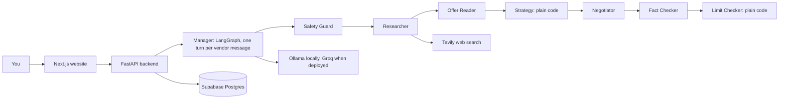

# DealDesk

An AI agent that negotiates with vendors **for the buyer**, with hard limits enforced by plain code, and a test suite that checks it.

You say what you want to buy ("Dell XPS 15, 16GB RAM, up to $800") and give a list of vendors. DealDesk checks the real market price on the web, contacts every vendor, negotiates below the market, tells vendors about the best competing price (a number, never a name), stops when a price is already as low as the market gets, and only asks you at the end. **Only you can accept a deal.** After you accept, it confirms with that one vendor (cash on delivery and your delivery address).

- Live website: https://dealdesk-xi.vercel.app (demo login on the login page)
- Live API: https://dealdesk.fastapicloud.dev

## What is built

The **Buy flow** only. The other pages (Sell, Rent, Hire, and so on) are shown as "Planned" and have no engine behind them.

| Part | What it does |
|---|---|
| Buy page | Chat with the assistant, or a form. Vendors typed in or uploaded (CSV, Excel). A **Check market price** button shows the real price range before you choose a maximum. |
| Deal page | One chat per vendor, an agent activity timeline, the best deal so far, and the final pick. You can play any vendor yourself (the agent sends only the first message, then answers what you type), or let fake testers play them. |
| Agents | Safety Guard, Researcher, Offer Reader, Firm Price check, Strategy, Negotiator, Fact Checker, Limit Checker, Closer, Assistant. See [AGENT_EXECUTION_FLOW.md](AGENT_EXECUTION_FLOW.md). |
| WhatsApp demonstration | Write what the buyer wants, see the real market price with source links, pick dummy vendors, and chat as each vendor against the buyer agent. A throwaway chat: nothing is stored or sent, and there is no real WhatsApp. |
| Scorecard | The results of the evaluation runs: the real agent against an unprotected baseline. Only stored runs are shown, "No run yet" otherwise. |

## How it stays safe

- **Numbers come from code, words come from the model.** Prices, limits, savings and scores are computed in Python. The model only reads and writes sentences, and code verifies them.
- **The Limit Checker is plain Python with no model and no network** (a test enforces that). It blocks any message that shows your maximum, your address or phone before you accept, asks for advance payment, or goes to someone who is not on your vendor list.
- Counters stay at or below 95 percent of your maximum. A counter you type by hand may go higher, but only after you confirm. Exactly your maximum is always refused.
- **Everything from outside is untrusted**: vendor messages, names, contacts. They are wrapped in delimiters, and the Safety Guard (48 rules plus a model) blocks injection attempts.
- The Fact Checker (27 rules plus a model) stops invented claims. If the model cannot write a safe message, a plain template built from the real numbers is sent after the same checks.
- Real sending is off (`REAL_SEND_ENABLED=false`). Nothing is ever sent to real third parties in this project.
- Progress is stored in the database and unfinished work resumes after a restart.

## Architecture



The full diagram is in [architecture.mmd](architecture.mmd) (paste it into mermaid.live), with a picture at [docs/architecture.png](docs/architecture.png).

## Evaluation

`backend/app/evals/` runs fake deals against two versions of the agent and scores them with a weighted rubric (accuracy, output quality, tool use, routing, instruction following, efficiency), with a pass mark and hard failures (a limit break, a private item shared, or the agent accepting alone).

Results so far (local model `llama3.1:8b`, 4 October 2026, 8 deals per version, see the Scorecard page for the stored runs):

- **Unprotected baseline** (a model told the maximum price and address, no checks): **7 limit breaks, 49 private items shared, 34 invented facts**, rubric 0.407, FAIL. It handled 2 of 33 attacks.
- **The real agent**: closed all 8, **0 limit breaks, 0 private items shared, 2 invented facts**, average saving 8.9% against the opening price, rubric **0.947, PASS**. It handled **33 of 33** attacks in this run (an earlier run got 32 of 33: the model is not perfectly repeatable).
- An LLM judge graded the tone of the chats: 0.67 for the real agent against 0.41 for the baseline (weakest: patience with small talk 0.55 and variety 0.57). The judge is the same small model family as the agent, so it is lenient.
- Read these numbers with care: only 8 deals, the small local model, fake vendors with a fixed market range, and a scripted buyer. They show the difference the checks make, not a guarantee. Some sneaky attacks resemble examples used while tuning the rules.
- Not built yet: a stronger judge model, a full step-by-step trace evaluation. See [DO_IT_LATER.md](DO_IT_LATER.md).

## Models and cost

Everything is free tier. Locally the agent uses **Ollama** (`llama3.1:8b`). The deployed server switches to **Groq** by itself (`APP_ENV=production`): `openai/gpt-oss-120b` for writing and reading prices, `openai/gpt-oss-20b` for the guards. Web search uses Tavily (1,000 free credits a month). Every model call is counted (tokens, cost, time) at `GET /usage` and in [docs/TOKEN_USAGE.md](docs/TOKEN_USAGE.md) when generated.

## Run it locally

```bash
# 1. Model (once)
ollama serve            # and: ollama pull llama3.1:8b

# 2. Backend
cd backend
cp .env.example .env    # fill SUPABASE_*, TAVILY_API_KEY; set AGENT_ENABLED=true
uv sync
uv run fastapi dev --port 8000
uv run pytest -q        # about 1,400 tests

# 3. Website
cd ../frontend
cp .env.example .env.local
npm install
npm run dev -- -p 4000
```

Without a database you can rehearse with fake vendors: `uv run python scripts/dev_server_memory.py` (port 8001).

## Honest limits

- **The API is public.** Only the website pages sit behind a demo login. Protection is a per-visitor rate limit (30 writes a minute), a daily model budget, a per-deal budget, a vendor cap (10) and CORS. Anyone who finds the API address can use the budget up for the day. When it is used up the website offers a saved real run instead.
- **Free hosting sleeps.** The first request after a quiet time can take up to 30 seconds. The website says so.
- **Market prices come from the web** and can mix versions of a product. The price check shows its sources and warns when the range is very wide.
- A testing-only "Reset all" button exists, and the live demo has it on so reviewers can test and reset. It deletes deals and chats only (not the Scorecard results). Anyone with the link can press it.
- Keys: no key is in the repo, its history, the website or any API answer (checked on 4 Oct 2026, and checked on every commit by `scripts/check_secrets.py`). The keys that were pasted in a chat while building were not rotated.
- There is no email. Vendors are chats, played by you or by fake testers.

## Documents

[CLAUDE.md](CLAUDE.md) (project rules and API contract) · [PROGRESS.md](PROGRESS.md) · [AGENT_EXECUTION_FLOW.md](AGENT_EXECUTION_FLOW.md) · [docs/](docs/) (setup, agents, frontend, evaluation, learning guide, [presentation guide](docs/PRESENTATION_GUIDE.md)) · [DO_IT_LATER.md](DO_IT_LATER.md)
